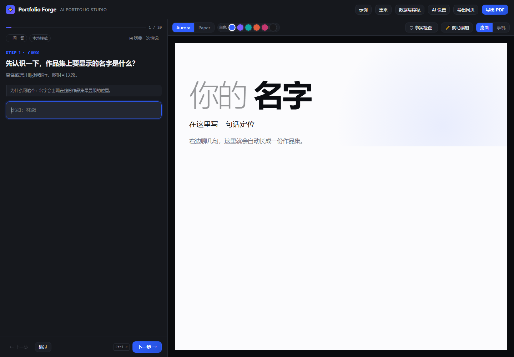
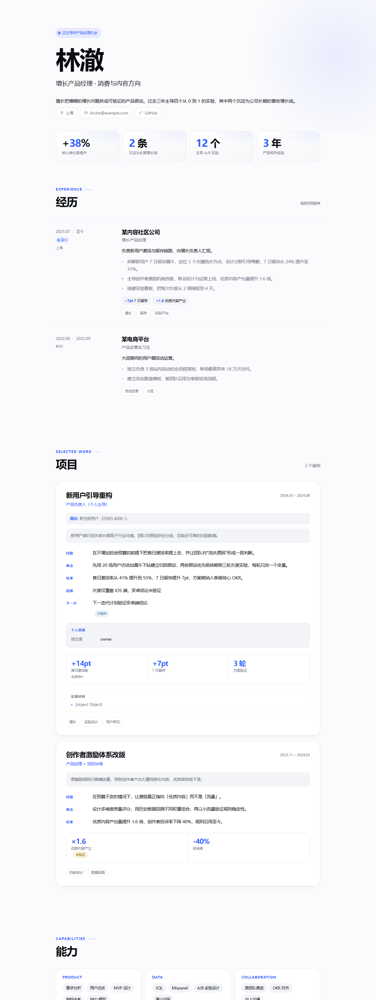

# ⚡ Portfolio Forge

> 把一段真实经历，整理成一份经得起追问的产品作品集。

纯前端、零后端、无需构建。打开网页，一个问题一个屏幕地回答，右边实时生成作品集，最后导出网页或 PDF。

**当前版本：v4.0** · [产品文档](docs/PRD.md) · [优先级与研究计划](docs/PRIORITY-AND-RESEARCH.md) · [诊断报告](docs/STAGE1-DIAGNOSIS.md)



---

## 它解决的不是"排版丑"

模板站和简历工具都能把话写漂亮，但解决不了这个问题：

> 面试官问"你这个 38% 是怎么算的"，你答不上来。

Portfolio Forge 的做法是：**在写的时候就把每句话的可信度标出来**。

| 状态 | 页面表现 | 意思 |
|---|---|---|
| 已确认事实 | 正常显示 | 你亲自做过，能说清来龙去脉 |
| 有材料支撑 | 正常显示 + 证据区块 | 有截图 / 文档 / 记录可查 |
| 你的陈述（未核实） | 正常显示 | 你说的，但目前没有材料 |
| 待验证假设 | 「未验证」徽标 | 推断、猜测 |
| 未来计划 | 「计划中」徽标 | 还没做 |
| 信息不足 | 「待补充」徽标 | 跳过了 |

徽标是给**读者**看的可信度信号。一份标了 3 处"未验证"的作品集，比一份看起来完美但一问就崩的作品集更可信。

---

## 首期只服务一种人

**在校生 / 应届生，找第一份产品经理或 AI 产品经理工作，手上有 0-2 段真实经历，但写不出作品集。**

其他方向（运营 / 设计 / 数据 / 开发）可以走基础流程，但没有深度追问和方法论卡。

**零素材的人**得到的是"去做一件真事"的 1 周练习路径，不是一份编出来的项目 —— 这是产品底线，不做假项目。

---

## 三分钟上手

### 本地打开

```bash
git clone <this-repo>
cd <this-repo>
python -m http.server 8080
# 打开 http://localhost:8080
```

> 直接双击 `index.html` 也能用，但 `file://` 下 PDF 组件可能受限，建议起个本地服务。

### 部署到 GitHub Pages

推送代码 → 仓库 **Settings → Pages → Source** 选 `GitHub Actions` → 自动部署到 `https://<用户名>.github.io/<仓库名>/`

---

## 怎么用

### 1. 一个问题一个屏幕

```
STEP 1 · 了解你
先认识一下，作品集上要显示的名字是什么？
（为什么问这个：名字会出现在整份作品集最显眼的位置）
[ 比如：林澈                    ]
                                    [跳过]  [下一步 →]
```

每个问题都有「为什么问这个」。这不是装饰 —— 知道为什么问，你才知道怎么答。

### 2. 零经历不会卡死

如果你说"什么都没有"，向导**不会**再问你实习经历，而是直接给出：

> 一份完整的产品分析报告 · 约 1 周 · 产出：3 页分析报告
> 步骤：挑一个你每天在用的 App → 写清它为谁解决什么问题 → 找出 2 个具体问题 → 提改进方案并说明取舍 → 找 3 个同学试用并记录反馈
> 做完你会有什么：报告本身、同学的试用反馈记录、你截图标注的问题界面

做完这些，你手上就真的有一个项目了。

### 3. 方法论卡：不只问，还教你怎么做

在"你怎么分析这个问题的原因"这一步，会根据你前面勾选的证据，自动给出一张方法卡：

> 📖 方法论卡 · 漏斗定位法
> **解决什么问题** 用户"流失了"但不知道卡在哪一步
> **怎么执行** 把行为拆成步骤，算每步转化率；断崖最大的一步就是问题所在
> **做完你该有什么** 每一步的转化率表格 + 断崖步骤的用户访谈记录
> **没有数据时** 手工记录：让 5 个同学走一遍流程，你记下每人卡在哪步。5 个人的记录也是真数据

现有 4 张：漏斗定位法 / 小样本访谈法 / 方案取舍法 / 指标口径法。

### 4. 数字不会被替你编出来

| 你输入 | 系统行为 |
|---|---|
| `41%→55%` | 存为两个指标 |
| `提升约30%` | 存为 30%，并标注"用户表述为估算值" |
| `不知道` | **不生成任何数字**，提示"你可以不填" |
| `很多` | **不生成任何数字** |
| `2023` | **不生成任何数字**（年份不是成果） |

### 5. 跳过的内容不会丢

跳过的问题进入底部「缺口清单」，一直显示在那里。点一下就能回去补，补完就消失。

### 6. 导出前强制体检

点导出时会先检查一遍：有没有标着"待补充"或"未验证"的内容。有就拦下来，让你先决定怎么处理。

快捷键 `Ctrl+K` 随时打开事实检查面板，四个动作：确认属实 / 补来源 / 标为假设 / 先不管。

### 7. 生成后随时改

打开「✏️ 就地编辑」，预览里点哪改哪，失焦自动保存。

---

## 两套主题

| 主题 | 气质 | 适合 |
|---|---|---|
| `aurora` | 现代科技，Bento 栅格，大字号 | 互联网 / 产品 |
| `paper` | 编辑质感，衬线标题 | 咨询 / 内容 |

主色 6 种预设，点一下即时生效。

---

## 隐私

| 数据 | 去向 |
|---|---|
| 你填写的所有内容 | 只存浏览器 localStorage，不出本机 |
| 渲染、PDF 生成 | 全在本地 |
| 你粘贴的 GitHub 链接 | 请求 `api.github.com`（仅此一处） |
| 其他链接 | **不解析**，提示手动补充 |

- 无后端、无账号、无埋点
- 「删除本机全部数据」按钮，一键清空
- 有未保存内容时离开页面会提醒

---

## 工作原理

```
你的回答
   │
   ▼
flow-engine.js    缺口驱动：现在最该问什么？
   │              · 跳过 → 记入缺口清单，不重复问
   │              · 撤销 → answers 栈 + 显式清字段
   ▼
fact-core.js      每条答案带状态
   │              · parseMetric：编不出数字就是编不出
   │              · buildLedger：导出前体检
   ▼
renderer.js       profile JSON → 自包含 HTML
   │              · 状态徽标 · 贡献度表 · 证据区块
   │              · URL 白名单 · 颜色白名单 · HTML 转义
   ▼
预览 / 导出 HTML / 导出 PDF
```

### 项目结构

```
├── index.html                 工作台主界面
├── src/
│   ├── renderer.js            渲染引擎（2 主题 + 事实徽标 + 安全过滤）
│   ├── fact-core.js           事实状态数据层（六态 / 指标解析 / 迁移 / ledger）
│   ├── flow-engine.js         缺口驱动流程引擎（提问 / 写回 / 缺口 / 撤销）
│   ├── role-kit.js            岗位知识库 + 练习路径 + 方法论卡
│   ├── fact-panel.js          事实检查面板
│   └── inline-edit.js         就地编辑
├── tests/
│   ├── audit-factcore.js      22 项断言
│   ├── flow-test.js           34 项断言
│   └── rolekit-test.js        13 项断言
├── docs/
│   ├── PRD.md                 产品需求文档 v4.0
│   ├── STAGE1-DIAGNOSIS.md    第一阶段诊断报告
│   └── archive/               历史版本
├── vendor/html2pdf.bundle.min.js
└── legacy/                    v1 表单版（不维护）
```

### 数据模型（v3 schema）

```js
{
  meta: { version:3, theme, accent, track:'pm'|'basic', stage, curProj, noExp, practice },
  hero: { name, title, tagline, location, email, phone, links[], available, badge },
  projects: [{
    name, role, period, link, description,
    fields: { problem:{text,status}, approach:{...}, result:{...}, context:{...} },
    users: { who, scale, status },
    evidence: ['data','interview','survey','self','desk','none'],
    contribution: { self:'owner'|'partial'|'support'|'unknown', team, ai, detail, status },
    alternatives: { text, status },
    limitations: { text, status },
    nextStep: { text, status },
    metrics: [{ value, label, status, note }],
    evidenceList: [{ name, link, status }],
    validation: [...]
  }],
  experiences: [...], skills: { groups: [...] }, education: [...], extras: [...]
}
```

旧数据（v2）打开时自动迁移，指标一律补 `status:'claim'` + `note:'来源待补'`。

---

## 跑测试

```bash
node tests/audit-factcore.js   # 通过 22 失败 0
node tests/flow-test.js        # 通过 34 失败 0
node tests/rolekit-test.js     # 通过 13 失败 0
```

合计 69 项。跑在 Node 的 `vm` 里，**不覆盖** DOM 交互、PDF 输出、真实浏览器渲染。

---

## 尚未完成（诚实清单）
| 项 | 状态 |
|---|---|
| LLM 润色 | ✅ 已实现（路线 A：自填 Key）。AI 输出强制标「未验证」，经 13 项 E2E 验证 |
| PDF 长文档分页 / 中文字体 / Safari | ⚠️ 未实测 |
| 事实检查面板的真实浏览器交互 | ⚠️ 逻辑完整，未手动点过 |
| 移动端 | ⚠️ 未测 |
| 真实用户研究 | ❌ 0 次访谈 |
| 其他岗位的深度流程 | ❌ 仅基础流程 |

完整清单与处理计划见 [docs/PRD.md](docs/PRD.md) 第 10 章。

## 界面验证截图

[docs/screenshots/](docs/screenshots/) 目录下有界面截图及复现方式，用于证明哪些部分是真正跑通的。没有截图的界面，在 PRD 里一律标为「未验证」。



---

## License

MIT
